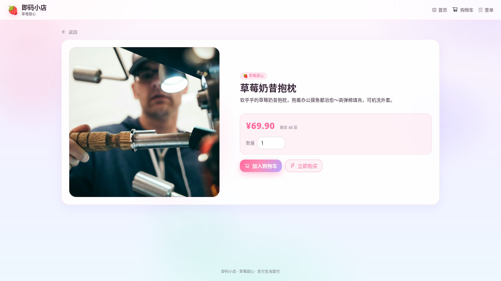
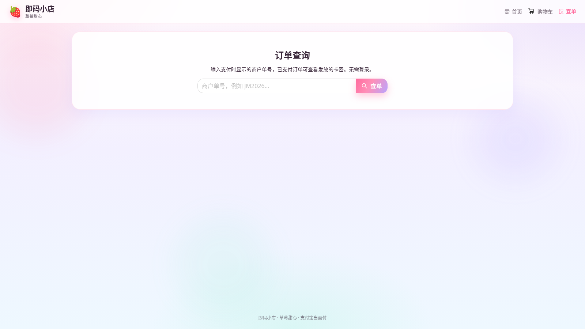
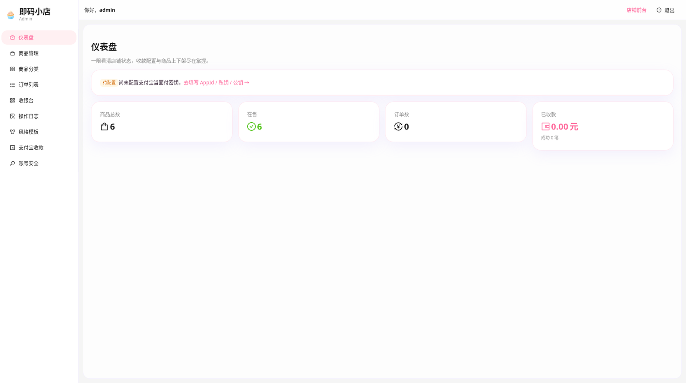
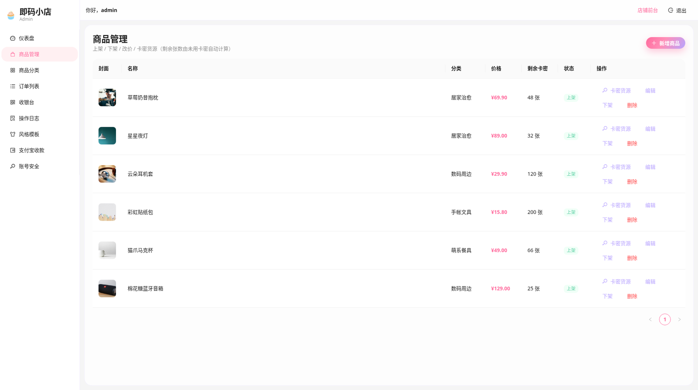

# 即码小店

[](./LICENSE)
[](https://github.com/MeLoser815/jima-shop/stargazers)

可自建部署的开源卡密商店。顾客在前台浏览商品并完成结算，通过支付宝当面付扫码付款后自动获得卡密；商户在后台管理商品、分类、订单、卡密货源与店铺风格。

数据存储使用 SQLite（better-sqlite3，WAL 模式）。标准部署只运行 **一个 API 进程**，由该进程同时提供接口和前端静态资源。请勿对同一数据库文件使用多进程写入，也不要启用 PM2 cluster。

本软件以 [MIT](./LICENSE) 许可证发布。

**上线前请使用新的空数据库。** 不要把开发环境中的示例商品或 `DEMO-` 前缀演示卡密用于对外销售；不要将 `.env`、数据库文件或密钥放入公开仓库或镜像。

## 界面预览

### 店铺前台






### 管理后台





## 功能

### 前台

- 响应式店铺：分类筛选、商品详情、购物车与结算
- 结账时预占卡密，再调用支付宝当面付 `alipay.trade.precreate` 生成收款码并轮询支付结果
- 可选视觉模板：草莓甜心、东方巨龙、神圣天使、次元集市
- 订单查询：仅已支付订单返回卡密，不返回买家账号等敏感字段

### 后台

- 首次启动时自行设置管理员账号与密码（bcrypt，密码至少 8 位）
- 仪表盘、商品与分类、订单、待补发订单的补发、操作日志
- 卡密货源导入（一行一条，或「卡号 + 卡密」）；库存按未用卡密计数
- 支付宝收款三要素在后台填写，密钥以 AES-GCM 加密入库
- 修改登录密码会使已有会话全部失效
- 管理员收银台（收款码 / 付款码）仅在后台提供，不在前台导航中展示入口

## 部署

将下列内容保存为 `docker-compose.yml`，在该文件所在目录执行 `docker compose up -d`。也可将同一段配置粘贴到 1Panel「容器 → 编排」，填写名称后启动。

```yaml
services:
  jima-shop:
    image: ghcr.io/meloser815/jima-shop:latest
    container_name: jima-shop
    restart: unless-stopped
    ports:
      - "3333:3001"
    environment:
      - TZ=Asia/Shanghai
      - NODE_ENV=production
    volumes:
      - ./data:/data
```

启动后访问 `http://服务器地址:3333` 打开店铺，访问 `http://服务器地址:3333/admin` 创建管理员账号。随后在后台「账号安全」中修改后台访问路径（默认 `/admin` 较容易被扫描），并在「支付宝收款」中填写 AppId、应用私钥、支付宝公钥，以及公网 HTTPS 异步通知地址（例如 `https://你的域名/api/payment/notify`）。收款与后台路径均可在后台完成，不必写入 Compose。

数据（含数据库，以及未手动指定时自动生成的会话密钥与加密密钥）保存在当前目录的 `./data` 中，请将该目录纳入备份。同一数据目录只运行一个实例。

对外收款前，请为站点配置域名和 HTTPS，再在后台填写对应的异步通知地址。未配置公网通知地址时，服务可以启动，但不能发起收款。

可选环境变量：`ADMIN_BASE_PATH`（若设置，将锁定后台路径且优先于后台中的修改；未设置时默认 `/admin`，可在后台「账号安全」中更改）、`SESSION_SECRET`、`SETTINGS_ENCRYPTION_KEY`（若自行指定，请使用足够长的随机串，且部署后不要更换加密密钥）、`WEB_ORIGIN`、`ALIPAY_NOTIFY_URL`（亦可在后台填写通知地址）。不要将占位示例值写入密钥变量。

若无法拉取镜像，可在本仓库根目录执行：

```bash
docker compose -f docker-compose.build.yml up --build -d
```

## 本地开发与非容器部署

需要 Node.js 22 或更高版本，以及 [pnpm](https://pnpm.io/)。

```bash
git clone https://github.com/MeLoser815/jima-shop.git
cd jima-shop
cp .env.example apps/api/.env
# 开发环境可先沿用示例密钥。使用 Docker 上线时，密钥可在数据目录自动生成，收款配置在后台填写。

pnpm install
pnpm dev
```

- 店铺前台：http://localhost:5173/
- 管理后台：http://localhost:5173/admin（默认路径；生产环境可在后台「账号安全」中修改，本地开发也可用 `ADMIN_BASE_PATH` 覆盖）
- API：http://localhost:3001

开发环境默认会写入示例分类、商品和 `DEMO-` 前缀演示卡密。若不需要演示数据，在环境变量中设置 `JIMA_SEED_DEMO=0` 后再以空的 `DATABASE_PATH` 启动。

### 非容器的生产启动

若不以 Docker 运行，仍须使用新的空数据库，设置强壮的 `SESSION_SECRET` 与 `SETTINGS_ENCRYPTION_KEY`，将 `ALIPAY_NOTIFY_URL` 设为公网 HTTPS，将 `WEB_ORIGIN` 设为站点的 https 源，并设置 `NODE_ENV=production`。在 HTTPS 反代后只运行一个 API 进程：

```bash
pnpm build
NODE_ENV=production pnpm start
# 或一次性：
NODE_ENV=production pnpm start:prod
```

生产模式下 API 会托管 `apps/web/dist`，将反代指到 API 端口即可。后台路径会在运行时注入页面；在后台修改后立即生效，无需重启。若使用环境变量 `ADMIN_BASE_PATH`，则以其为准，需重启后生效。

若使用 PM2，请使用 fork 模式且 `instances=1`，不要开启 cluster。

## 配置与首次使用

环境变量说明见仓库根目录的 [`.env.example`](./.env.example)（本地开发复制为 `apps/api/.env`）以及上文的 Compose 环境变量表。前端开发服务器会读取同一份 `apps/api/.env`（或仓库根目录的 `.env`），`ADMIN_BASE_PATH` 只需配置一处。

后台路径的真实安全依赖管理员鉴权、会话作废和接口限流，而不是路径本身的隐蔽性。

首次打开后台会进入安装流程，自行设置管理员用户名和密码。登录后建议按以下顺序完成配置：

1. 在「风格模板」中选择前台皮肤
2. 在「商品分类」与「商品管理」中维护分类并上架商品
3. 在商品的「卡密货源」中导入卡密
4. 在「支付宝收款」中填写 AppId、应用私钥和支付宝公钥

生产镜像与 `NODE_ENV=production` 启动都不会自动写入示例商品或演示卡密。

### 主要路径

| 路径 | 说明 |
|------|------|
| `/` | 店铺首页 |
| `/p/:id` | 商品详情 |
| `/cart` | 购物车 |
| `/pay` | 确认订单 / 收款码 |
| `/order`、`/query` | 查单 |
| `/admin` | 仪表盘（默认后台路径，可在「账号安全」中修改） |
| `/admin/products` | 商品管理 / 卡密货源 |
| `/admin/categories` | 分类管理 |
| `/admin/orders` | 订单（含补发） |
| `/admin/cashier` | 管理员收银台 |
| `/admin/audit` | 操作日志 |
| `/admin/appearance` | 风格模板 |
| `/admin/settings` | 支付宝配置 |
| `/admin/account` | 账号安全（含后台路径） |

买家支付轮询只走公开查单接口。`/api/payment/precreate`、`/api/payment/pay` 仅管理员可用。

## 备份

Docker 部署时，请备份主机上的 `./data` 目录，同时妥善保管 `SETTINGS_ENCRYPTION_KEY` 与 `SESSION_SECRET`。仅复制数据库文件而没有加密密钥，将无法解密卡密和支付宝配置。

进行一致性备份时，不要在服务运行中直接 `cp` 正在使用的数据库文件。可在容器内调用备份命令，将快照写入数据卷：

```bash
docker compose exec jima-shop node dist/scripts/backup.js /data/jima-backup.db
```

非容器部署使用：

```bash
pnpm backup
# 或指定路径：
pnpm --filter @jima/api backup /safe/path/jima-backup.db
```

备份包含加密后的密钥与卡密，应按机密保管，建议文件权限 `0600`。

## 生产环境注意事项

- 使用新的空数据库上线，不要直接沿用开发库。
- 生产环境若将 `SESSION_SECRET` 或 `SETTINGS_ENCRYPTION_KEY` 设为示例占位值，进程会拒绝启动；未设置时将在数据目录自动生成并保存。若设置了 `ALIPAY_NOTIFY_URL`，必须是公网 HTTPS。
- 同一 SQLite 文件只允许一个写入进程。
- 已售或已预占卡密的商品不可删除，请下架以保留发货记录。
- 不要将 `.env`、`*.db`（含 `-wal` / `-shm`）或备份提交到 Git。

## 技术栈与常用脚本

TypeScript、pnpm workspace、Node.js 22。后端为 Fastify、better-sqlite3、官方 `alipay-sdk` 与 bcryptjs；前端为 React、Vite 与 Ant Design。

```bash
pnpm dev          # 本地前后端同时启动
pnpm build
pnpm test
pnpm typecheck
pnpm start        # 需先 build
pnpm start:prod   # build 后启动（须配合 NODE_ENV=production 与生产环境变量）
pnpm backup       # 一致性备份
```

## Star 趋势

[](https://www.star-history.com/#MeLoser815/jima-shop&Date)

## License

[MIT](./LICENSE) © 2026 jima-shop contributors
